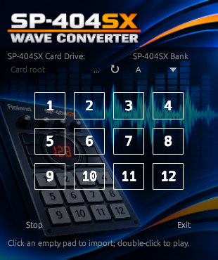

# SP-404SX/A Wave Converter

A Rust desktop sample manager for an SP-404SX/A-formatted card or card copy.
**Back up the entire card before making changes.** Writing has been tested on
isolated fixtures, not verified on the sampler; compatibility is not guaranteed.
Do not modify the card concurrently with another program or remove it during an
operation.



```sh
cargo run -- gui /path/to/card
```

On Linux, build and install the application and desktop launcher with:

```sh
make
make install
```

The default install prefix is `~/.local`; use `make install PREFIX=/usr/local`
to choose another prefix, and `DESTDIR` for staged packaging. The GUI embeds
`assets/icon-256.png`, a resized copy of `icon.png`, which is also installed
for the desktop launcher. To regenerate it after changing `icon.png`, run
`magick icon.png -resize 256x256 assets/icon-256.png`. The GUI also embeds
`bg.png` as its background skin; rebuild after changing the image.

Use **...** to select the mounted card's root folder, or enter the path and
press Enter or refresh. The last successfully opened folder is remembered in
`$XDG_CONFIG_HOME/sp404sx-wave-converter/last-card-folder` (or
`~/.config/sp404sx-wave-converter/last-card-folder`) and reopened on startup.
A card path supplied on the command line takes precedence. Choose a bank, then
click an empty pad to import an
uncompressed WAV or AIFF. To replace a sample, select its pad and use
**Import**; **Delete** removes the selected sample. Both replacement and
deletion require confirmation. Double-click an assigned pad to preview it;
click the playing pad or **Stop** to stop.

Import requires `ffmpeg` and `ffprobe` on `PATH`. Mono and stereo PCM input
is converted to 44.1 kHz, 16-bit WAV. Imports reset the selected pad's
settings and set its tempo to 120 BPM; automatic tempo detection is not
implemented. Preview requires `ffplay` and applies the recorded start/end
offsets, but does not reproduce other sampler effects or pad settings.
Conversion runs synchronously and the window may be unresponsive during a
large import.

The command line also supports read-only listing and full-file playback:

```sh
cargo run -- list /path/to/card A
cargo run -- play /path/to/card A 1
```

For a CLI-only build, use `cargo build --no-default-features`. Linux GUI builds
need the system libraries required by `eframe`/`winit` and a native file dialog
backend.

## Recovery and limitations

Writes are staged in `ROLAND/SP-404SX/SMPL/.sp404sx-converter-transaction`.
The program attempts to roll back failed renames and refuses further writes
if this directory is present. Multi-file updates are **not crash-atomic**:
power loss, disconnection, or cleanup failure can leave the card inconsistent
or a partially cleaned transaction. Stop using the card, preserve a copy of
the entire card and transaction directory, and restore the independent backup
if necessary. When present, `operation.txt`, `PAD_INFO.original`, and
`original.sample` may help inspect an interrupted operation; do not assume
all of them survived. Do not remove the transaction directory until the card
has been checked or restored.

SP-404 CompactFlash conversion is not implemented: its source format and
destructive conversion behavior have not been verified. The card's tempo
detection and full hardware behavior likewise remain unverified.

## Format references

Sample layout follows the [SP-404SX sample format notes](https://gist.github.com/threedaymonk/701ca30e5d363caa288986ad972ab3e0)
and observations from a card. Pad metadata fields are informed by the
[PAD_INFO parser](https://raw.githubusercontent.com/uttori/uttori-data-tools/master/src/audio/sp404-padinfo.ts).
